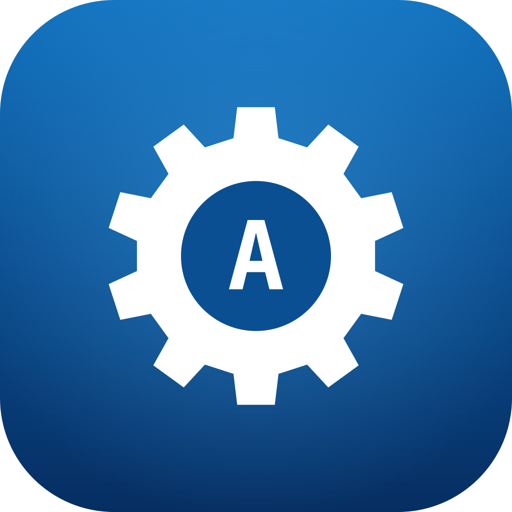

### <br>

<p align="center">
  

  <h3 align="center">bada enigma</h3>

  <p align="center">
	A joke input method. Henkan mode types through an Enigma machine.
  </p>
</p>

### <br>

> [!WARNING]
> Do not use as a password or encryption mechanism for anything serious. Germany lost.

[**Try it out!**](https://enigma.sjun.me/)

bada enigma is a [bada-compatible](https://github.com/team-mirae/bada-compatible) v1.1 IME engine.
Any bada-compatible wrapper runs it: [bada ime](https://github.com/team-mirae/bada-ime)'s shells,
[bada-windows](https://github.com/team-mirae/bada-windows),
[superkeyboard](https://github.com/team-mirae/superkeyboard) (`imes/enigma.json`), and this
repository's web page.

## How it types

- **英数 (muhenkan)**: plain typing. 半角/全角 enciphers the selection.
- **かな (henkan)**: every letter goes through the machine. The preedit shows the ciphertext; Tab
  picks another form (CAPITALS, lowercase, groups of five, or the plaintext if you're cheating).
  Space, Enter and the other keys commit.
- **Every henkan session is a new starting state.** A session is one preedit, from its first
  letter to its commit; each starts with the rotors at the starting state in the settings.
- **Backspace unwinds the state**: the rotors turn back with the letter.
- The machine is reciprocal: typing the ciphertext again, from the same starting state, gives back
  the plaintext.

## Settings

```json
{
  "rotors": ["I", "II", "III"],
  "reflector": "B",
  "rings": "AAA",
  "start": "AAA",
  "plugboard": "AV BS CG DL FU HZ IN KM OW RX",
  "forms": ["upper", "lower", "groups", "plain"],
  "space": "commit"
}
```

An Enigma I / M3: three different rotors from I–VIII (left to right), reflector A, B or C, ring
settings (Ringstellung), the starting state (Grundstellung) and up to 13 plugboard pairs.
`"space": "x"` makes Space type an X into the message, as the operators did. Invalid fields fall
back to their defaults. The machine is tested against the Operation Barbarossa message (1941).

## The web page as a proof of concept

`web/` shows how a bada-compatible engine becomes a web app with no glue crate and no
wasm-bindgen: the engine crate itself is compiled to `wasm32-unknown-unknown`, and the page calls
its **C ABI as is** (`enigma_new`, `enigma_key`, …), writing NUL-terminated JSON into memory from
`wasm_alloc` (`src/wasm.rs`, the only web-specific Rust) and reading C strings back
(`web/src/engine.js`). The page is a bada-compatible host (spec §7) in about 300 lines of JS.
To do the same for another engine: copy `src/wasm.rs`, build for wasm32, and change the prefix in
`engine.js`.

`enigma_machine` is this engine's one extra function (not part of the standard): the rotor windows
and the lit lamp, for the lampboard.

## Build

```sh
cargo test                       # the machine, the IME, the bada-compatible conformance checklist
cargo clippy --all-targets
cargo build --release            # target/release/libenigma.{dylib,so,a}
node web/build.mjs               # web/dist (needs the wasm32-unknown-unknown target)
node web/test/smoke.mjs          # the wasm engine through its C ABI
python3 -m http.server -d web/dist
```

Deployed by Vercel's Git integration on every push to main (`vercel.json`): Vercel's build image
has no Rust, so `web/vercel-build.sh` installs a minimal toolchain first.

## License

CC0 1.0. `src/compat/` and `docs/bada-compatible-v1.md` are from
[team-mirae/bada-compatible](https://github.com/team-mirae/bada-compatible), also CC0.
